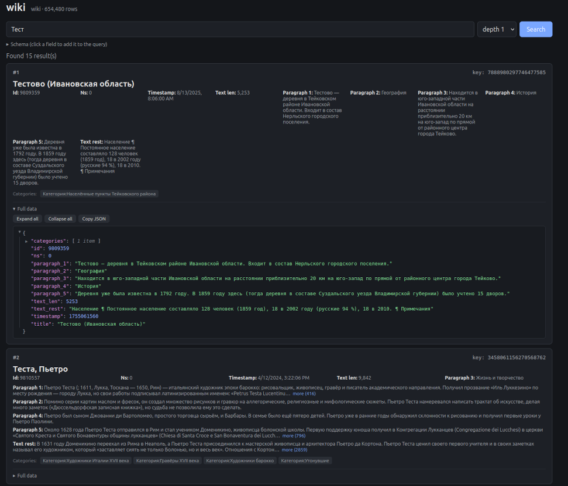

# Storage matters more than the fancy algorithm
 
Storage is often a more important question than a trendy algorithm.
 
Programming languages moved away from bytes long ago and gave us comfortable
numbers, characters and strings. The convenience has a price: a person's age
often sits in an int64 although one byte would do, and the genre "Drama" is
repeated as a string in a million rows. A missing value takes as much space as
a real one.
 
A catalog ends up weighing gigabytes, and much of it is zeros and repeats.
 
CompactRamTable is a small project to demonstrate one idea: if every column is
given the representation that fits its data, most of that weight disappears.
It happens once, in `Compact`.
 

## Numbers: scaling
 
Values rarely use the full range of their type. If a column holds integers from
2000 to 2026, there is no reason to spend 4 or 8 bytes on each. The table stores
the minimum once and, per row, only the offset from it, in the smallest width
that fits: 1, 2, 4 or 8 bytes.
 
    2000, 2005, 2010, 2000  ->  min = 2000,  offsets 0, 5, 10, 0  (1 byte each)
 

## Numbers with few distinct values: enum
 
A column with at most 256 distinct values needs one byte per row, however large
the values themselves are. The distinct values are stored once, and each row
keeps only the number of its value.
 
    19999, 2003021030, 19999, 2003021031  ->  dictionary: 1=19999, 2=2003021030, 3=2003021031
                                              rows: 1, 2, 1, 3  (1 byte each)

## Missing values: a bitmap, not zeros
 
A list of a million int64 zeros takes 8 MB and holds no information. Emptiness
is information too, but it can cost one bit.
 
    19999, null, null, 2003021030, 19999
      presence bitmap:  1 0 0 1 1
      dense values:     1, 2, 1   (enum numbers of the three real values)
      total:            3 bytes + 5 bits
 
A null is a bit in a bitmap, and the values array keeps only the real values.
A column that is 98% empty costs about one bit per row, plus a small index for
fast lookup. That is why wide, sparse tables are cheap: you can afford a column
for every optional attribute.

## Strings: the alphabet does not have to be 30 letters
 
The textbook view of a string is a sequence of characters from a small
alphabet: about 30 letters, so one or two bytes each. But nothing forces us to
use letters as the alphabet. Words work just as well, and there are millions of
them.
 
The table builds a dictionary of words and stores each word as a numeric token
of a few bytes, however long the word is. The token width grows with the
vocabulary: 2 bytes for a small one, 4 bytes for 1.5 million entries. Natural
language is very skewed: a small share of words covers most of the text. A word
that took many bytes of UTF-8 becomes one token, and the dictionary, built
once, is shared by all text columns. Rare words that are not in the dictionary
are split into smaller pieces. The bigger the text, the better this pays off,
because the dictionary grows much more slowly than the text does.
 
Characters are the right alphabet only if you know nothing about your data.
A catalog usually knows a lot.

## A quick check on Wikipedia
 
I loaded part of the Russian Wikipedia dump (3.6 GiB of XML, 624 MiB as bz2)
into one table of 654 thousand rows and 53 columns: five paragraphs and the
rest of the text, categories, links, titles with an index, and infobox
parameters for films, musicians, albums and settlements.
 
- Text: about 1.3 GiB of raw strings became about 650 MiB inside the table
  file (roughly half), plus a one-time vocabulary of about 40 MiB with 1.5
  million entries.
- The whole table, with all columns, categories, links and the title index:
  744 MiB.
- 34 infobox columns, filled for only ~13.6 thousand of 654 thousand rows,
  take about 3.5 MiB together: a few hundred KiB per column.
This is not an archiver. The compressed dump is 624 MiB, and the table is a bit
larger, because it keeps cleaned text with structure, cross-references, an
index and random access to every value.

    go run ./wiki_test/wiki_loader.go -dump ruwiki-latest-pages-articles-multistream6.xml-p9585766p11085765.bz2 -store ./ruwiki_one 
    go run ./wiki_test/wiki_loader.go -store ./ruwiki_one  localhost:8080 for search ui
    
    

The point is not the final number. The right types did not make the algorithm
smarter; they just stopped paying for what the data does not contain.
 

## Real projects: do not skip these settings
- DuckDB Compression is automatic per column chunk: nothing to switch on.
- ClickHouse  
    The default is plain LZ4 with no pre-encoding. Set a codec per column:
    Use `LowCardinality(String)` for enums, pick the narrowest types (`UInt8`, `UInt16`, `Date`, `DateTime`)
-  PostgreSQL
    - It is a row store, so it will not compress columns for you. Choose narrow types by hand:
Whatever you use: pick the narrowest type that fits, use dictionary encoding
for repeated values, never pay for NULLs or repeats your data does not contain,
and measure before and after.

